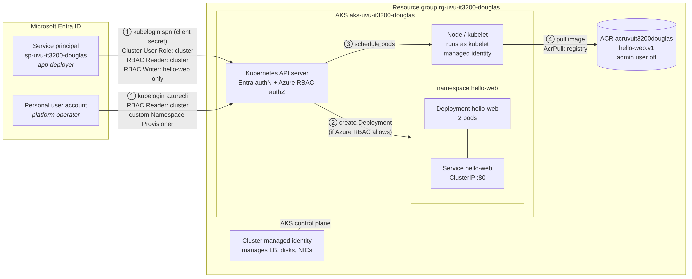
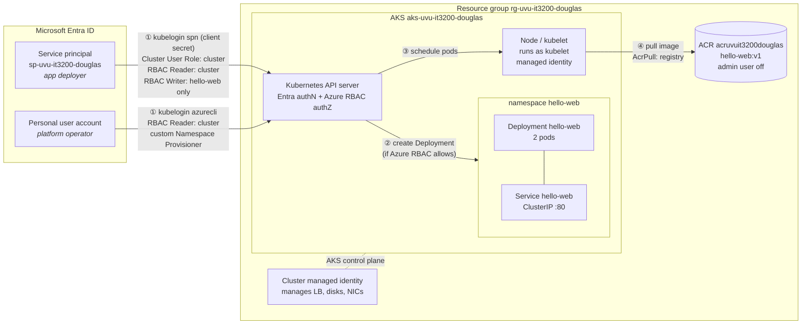

# Architecture

There are **two separate access flows**. They use different identities, and permission on one does nothing for the other.

Source (renders on GitHub):

## Flow 1: Kubernetes API access (people and automation)

1. The caller signs in to **Microsoft Entra ID**. The service principal uses its client ID + secret (`kubelogin -l spn`), your account uses the Azure CLI session (`kubelogin -l azurecli`). This is **authentication**.
2. kubectl sends the Entra token to the AKS API server. Because the cluster has **Azure RBAC for Kubernetes authorization** enabled and local accounts disabled, the API server asks Azure RBAC whether the identity has a role whose *dataActions* allow the request (for example `.../namespaces/hello-web` + `apps/deployments/write`). This is **authorization**.
3. If allowed, the Deployment is created and the scheduler places pods on the node.

## Flow 2: Image pull (the cluster itself)

4. The kubelet on the node needs the image `acruvuit3200douglas.azurecr.io/hello-web:v1`. It authenticates to ACR as the **kubelet managed identity**, which has `AcrPull` on the registry. The service principal is not involved at all.

## Plain-language version

- **Entra ID** is the company badge office: it proves who you are.
- **Azure RBAC role assignments** are the access list on each door.
- The **service principal** is the deployment robot's badge. It can open the `hello-web` room and look through the windows of other rooms, but it cannot build new rooms or open the server closet (nodes).
- **Your account** is the building operator: it can see the building and create new rooms, but it does not move furniture inside the app room.
- The **kubelet identity** is the delivery truck's badge: it can only pick up packages (images) from the warehouse (ACR).
- The **cluster identity** is the facilities crew: it manages the cluster's own Azure plumbing (load balancer, disks).
